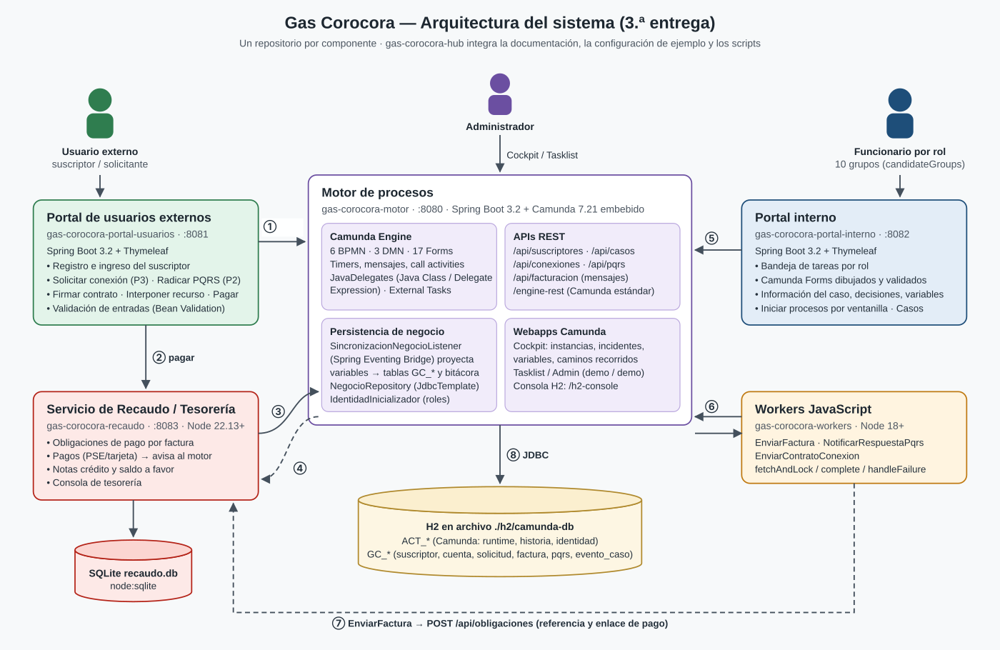
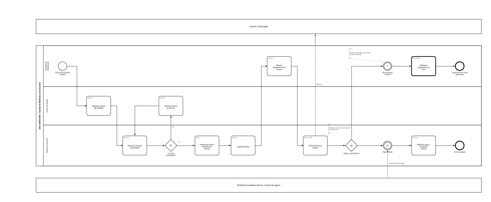
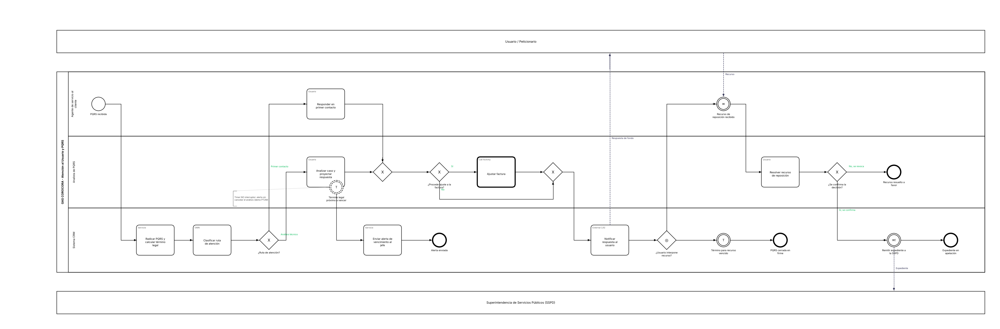
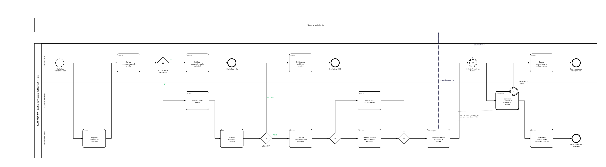

# Gas Corocora — Hub del proyecto (3.ª entrega)

**Software Basado en Procesos de Negocio · Universidad de los Llanos**

Hub integrador del multirepositorio de **Gas Corocora S.A. E.S.P.**: aquí están el alcance, la arquitectura, la guía de instalación de todo el sistema, la configuración de ejemplo, los scripts de arranque, los casos de prueba y el guion de la demostración. El código de cada componente vive en su propio repositorio.

| Integrante | Código | Proceso a cargo |
|---|---|---|
| Marlon Fabian Santofimio Romero | 160004837 | P2 · Atención al Usuario y PQRS (+ subproceso Ajuste de Factura) |
| Brayan Steven Acosta Vigoya | 160004800 | P3 · Conexión de Nuevos Usuarios (+ subproceso Construcción de Acometida) |
| Andrés Santiago Chavarro Pardo | 160004913 | P1 · Medición y Facturación (+ subproceso Suspensión por Mora) |

---

## 1. Contexto y alcance

### Organización
Gas Corocora S.A. E.S.P. es una empresa (ficticia, de uso académico) de **distribución de gas natural domiciliario** en Villavicencio y municipios del Meta. Atiende a suscriptores residenciales, comerciales e industriales y está vigilada por la Superintendencia de Servicios Públicos Domiciliarios (SSPD) bajo la Ley 142 de 1994.

### Problema
Del portafolio de procesos de la empresa se priorizaron tres por importancia, salud y factibilidad:

| Proceso | Problema que se ataca |
|---|---|
| **P1 Medición y Facturación** | Alrededor de 1 de cada 10 facturas genera reclamo por errores de lectura manual; el pago y la mora se controlan a mano. |
| **P2 Atención al Usuario y PQRS** | En los picos posteriores a la facturación se incumplen los 15 días hábiles de respuesta (art. 158, Ley 142), con riesgo de sanción de la SSPD. |
| **P3 Conexión de Nuevos Usuarios** | El ciclo de conexión se alarga por demoras en la viabilidad técnica, la radicación de documentos y la obra del contratista. |

### Objetivo
Automatizar los tres procesos sobre **Camunda 7**, con una aplicación para los usuarios externos, una aplicación de trabajo para los funcionarios por rol, un servicio adicional de **Recaudo / Tesorería** integrado al flujo y una base de datos de negocio vinculada a las instancias de proceso.

### Participantes

| Participante | Tipo | Cómo interactúa |
|---|---|---|
| Suscriptor / solicitante | Externo | Portal de usuarios: se registra, solicita la conexión, firma el contrato, radica PQRS, interpone recursos y paga |
| Asesor comercial, ingeniero de redes, contratista, inspector de calidad | Internos (P3) | Portal interno, tareas de su rol |
| Lector de campo, analista de facturación, técnico de suspensión | Internos (P1) | Portal interno |
| Agente de servicio, analista de PQRS, jefe de servicio al cliente | Internos (P2) | Portal interno |
| Tesorería (servicio de Recaudo) | Sistema | Recibe obligaciones, pagos y notas crédito; avisa al motor |
| SSPD | Externo (pool colapsado) | Recibe el expediente en apelación (mensaje *throw*) |
| Administrador | Interno | Cockpit / Tasklist / Admin de Camunda |

### Alcance

**Incluye:** los 3 procesos principales y sus 3 subprocesos (call activities), 3 decisiones DMN, 17 Camunda Forms, 2 aplicaciones web, el servicio de Recaudo, 3 workers externos, persistencia de negocio con bitácora, usuarios y grupos por rol, scripts de instalación y casos de prueba.

**No incluye:** pasarela de pagos real (el pago es simulado y no pide datos bancarios), envío real de correos (los workers lo registran en consola), autenticación corporativa (se usa la identidad de Camunda) ni despliegue en la nube. Docker es opcional y no se usa.

### Responsabilidades

Cada integrante responde por **su proceso de punta a punta**: modelo BPMN y subproceso, DMN, Camunda Forms, delegates y worker del proceso, sus pantallas en los portales, sus casos de prueba (sección 10) y su parte de la demostración.

| Integrante | Artefactos del proceso | Componente transversal |
|---|---|---|
| Andrés Santiago Chavarro Pardo | `ProcesoMedicionFacturacion.bpmn`, `SubprocesoSuspensionServicio.bpmn`, `DecisionFactorTarifario.dmn`, 5 formularios, `EnviarFacturaWorker.js`, casos CP-P1-* | gas-corocora-recaudo (obligaciones y pagos) |
| Marlon Fabian Santofimio Romero | `ProcesoAtencionPqrs.bpmn`, `SubprocesoAjusteFactura.bpmn`, `DecisionRutaAtencionPqrs.dmn`, 5 formularios, `NotificarRespuestaPqrsWorker.js`, casos CP-P2-* | gas-corocora-portal-usuarios |
| Brayan Steven Acosta Vigoya | `ProcesoConexionNuevosUsuarios.bpmn`, `SubprocesoConstruccionAcometida.bpmn`, `DecisionViabilidadTecnica.dmn`, 7 formularios, `EnviarContratoConexionWorker.js`, casos CP-P3-* | gas-corocora-portal-interno |
| Todos | Motor (gas-corocora-motor), persistencia, hub y documentación | — |

---

## 2. Arquitectura del sistema



(Fuente editable: [`docs/arquitectura.svg`](docs/arquitectura.svg))

### Componentes

| Componente | Repositorio | Tecnología | Puerto | Responsabilidad |
|---|---|---|---|---|
| Motor de procesos | `gas-corocora-motor` | Java 17, Spring Boot 3.2.0, **Camunda 7.21.0** embebido | 8080 | Ejecuta BPMN/DMN/Forms; JavaDelegates; API de negocio (`/api/*`) y API de Camunda (`/engine-rest`); Cockpit/Tasklist; persistencia de negocio y bitácora |
| Base de datos del motor | (dentro del motor) | H2 2.x en archivo | — | Tablas `ACT_*` de Camunda + tablas `GC_*` de negocio |
| Portal de usuarios externos | `gas-corocora-portal-usuarios` | Spring Boot 3.2 + Thymeleaf | 8081 | Registro, trámites, firma, recurso y pago |
| Portal interno | `gas-corocora-portal-interno` | Spring Boot 3.2 + Thymeleaf | 8082 | Bandeja por rol, formularios de tarea, casos, inicio de procesos |
| Servicio de Recaudo / Tesorería | `gas-corocora-recaudo` | Node 22.13+, `node:http`, `node:sqlite` | 8083 | Obligaciones, pagos, notas crédito y saldo a favor |
| Workers externos | `gas-corocora-workers` | Node 18+, camunda-external-task-client-js | — | Tareas *External* de los tres procesos |
| Hub | `gas-corocora-hub` | Markdown + scripts | — | Documentación general, configuración de ejemplo, arranque y pruebas |

### Conexiones (números del diagrama)

| # | Origen → destino | Protocolo / endpoint | Para qué |
|---|---|---|---|
| ① | Portal usuarios → Motor | REST `/api/suscriptores`, `/api/conexiones`, `/api/pqrs`, `/api/casos` | Registrar/autenticar, **iniciar P3 y P2**, correlacionar **firma** y **recurso**, consultar trámites con su estado vivo |
| ② | Portal usuarios → Recaudo | REST `GET /api/obligaciones/{factura}`, `POST /api/pagos` | Mostrar el saldo y pagar |
| ③ | Recaudo → Motor | REST `POST /api/facturacion/facturas/{n}/pagos` | Correlacionar **`MensajePagoRecibido`** en P1 |
| ④ | Motor → Recaudo | REST `POST /api/notas-credito` (`NotaCreditoDelegate`, asíncrono) | Aplicar el ajuste aprobado en la PQRS |
| ⑤ | Portal interno → Motor | REST `/engine-rest/identity`, `/task`, `/task/{id}/deployed-form`, `/submit-form`, `/process-definition/key/{k}/submit-form`, `/api/casos` | Ingreso por rol, bandeja, formularios, completar tareas, iniciar procesos, información del caso |
| ⑥ | Workers ↔ Motor | REST `/engine-rest/external-task` (fetchAndLock, complete, failure) | Ejecutar las tareas *External* |
| ⑦ | Worker `EnviarFactura` → Recaudo | REST `POST /api/obligaciones` | Crear la obligación y traer referencia y enlace de pago |
| ⑧ | Motor ↔ H2 | JDBC | Camunda + `GC_*` (listener de eventos y `NegocioRepository`) |

### Correspondencia aplicaciones ↔ proceso

| Elemento BPMN | Proceso | Quién lo atiende | Aplicación |
|---|---|---|---|
| Inicio *Solicitud de conexión recibida* | P3 | Solicitante / asesor | Portal usuarios (*Solicitar conexión*) o portal interno (*Iniciar proceso*) |
| Inicio *PQRS recibida* | P2 | Usuario / agente | Portal usuarios (*Radicar PQRS*) o portal interno |
| Inicio *Ciclo de facturación iniciado* | P1 | Analista de facturación | Portal interno |
| Tareas de usuario (14) | P1–P3 y subprocesos | Grupo candidato de la lane | Portal interno (bandeja por rol) |
| Mensaje *Contrato firmado* | P3 | Solicitante | Portal usuarios (*Firmar contrato*) |
| Mensaje *Recurso de reposición recibido* | P2 | Usuario | Portal usuarios (*Interponer recurso*) |
| Mensaje *Pago recibido* | P1 | Usuario → Recaudo | Portal usuarios (*Pagar*) → Recaudo → motor |
| Tarea *Aplicar nota crédito* | Ajuste de factura | Sistema | Motor → Recaudo |
| Tarea *Enviar factura al usuario* (External) | P1 | Worker | Workers → Recaudo |

---

## 3. Modelado BPMN

Los modelos editables (Camunda Modeler 5.x, plataforma Camunda 7.21) están en [`gas-corocora-motor/src/main/resources/static/bpmn/`](../gas-corocora-motor/src/main/resources/static/bpmn), las DMN en `static/dmn/` y los formularios en `static/forms/`. Las vistas previas están en [`docs/diagramas/`](docs/diagramas). La presentación de la entrega anterior quedó en [`docs/entregas-anteriores/`](docs/entregas-anteriores).

Cada proceso es una **colaboración**: un pool ejecutable con lanes por rol y pools externos colapsados (usuario, entidad recaudadora, SSPD) unidos por *message flows*.

### P1 — Medición y Facturación (`Proceso_MedicionFacturacion`)

- **Lanes:** Analista de facturación · Lector de campo · Sistema comercial.
- **Flujo:** registrar lectura → calcular consumo y desviación → XOR *¿Lectura consistente?* (si la desviación supera el 30 %, *Verificar lectura en terreno* y se recalcula) → DMN *factor tarifario por estrato* → liquidar → revisar liquidación → **External** *Enviar factura* (crea la obligación en Recaudo) → **event-based gateway**: mensaje *Pago recibido* o timer *Plazo vencido* → registrar pago **o** call activity *Suspensión por mora* (`Proceso_SuspensionServicio`: orden, ejecución en terreno, XOR, fecha con expresión `${now()}`).

### P2 — Atención al Usuario y PQRS (`Proceso_AtencionPqrs`)

- **Lanes:** Agente de servicio · Analista de PQRS · Sistema CRM.
- **Flujo:** radicar y calcular término legal (15 días hábiles) → DMN *ruta de atención* → XOR: *Responder en primer contacto* o *Analizar caso* (con **timer no interruptor** que alerta al jefe antes del vencimiento) → XOR *¿Procede ajuste?* → call activity *Ajuste de factura* (`Proceso_AjusteFactura`: aprobar, XOR, **aplicar nota crédito en Recaudo**) → **External** *Notificar respuesta* → **event-based gateway**: mensaje *Recurso de reposición* o timer → *Resolver recurso* → XOR → mensaje **throw** *Remitir expediente a la SSPD* o *Recurso resuelto a favor*.

### P3 — Conexión de Nuevos Usuarios (`Proceso_ConexionNuevosUsuarios`)

- **Lanes:** Asesor comercial · Ingeniería de redes · Sistema comercial.
- **Flujo:** registrar solicitud → revisar documentos → XOR (devolución) → visita técnica → DMN *viabilidad técnica* → XOR (no viable) → cotización → **AND** (diseño de acometida ∥ contrato de condiciones uniformes) → **External** *Enviar cotización y contrato* → mensaje *Contrato firmado* → call activity *Construcción de acometida* (`Proceso_ConstruccionAcometida`: obra, inspección, XOR con retorno, certificado) con **timer interruptor** de plazo de obra → *Escalar incumplimiento* → matricular usuario.

### Decisiones DMN

| Decisión | Entradas | Salida | Hit policy |
|---|---|---|---|
| `Decision_FactorTarifario` | tipoUsuario, estrato | porcentajeAjuste (E1 −50, E2 −40, E3 −15, E4 0, E5–6 +20, comercial +20, industrial 0) | UNIQUE |
| `Decision_RutaAtencionPqrs` | tipoSolicitud, valorReclamado | RESPUESTA_INMEDIATA (sugerencia, petición, reclamo ≤ 50.000) / ANALISIS_TECNICO | FIRST |
| `Decision_ViabilidadTecnica` | capacidadRedSuficiente, distanciaRedMetros, tipoPredio | VIABLE (≤ 40 m) / VIABLE_CON_EXTENSION / NO_VIABLE | FIRST |

**Elementos avanzados usados:** call activities con *business key* y `in/out variables="all"`, event-based gateways, timers interruptor y no interruptor parametrizados (`${plazosProceso.*}`), mensajes catch y throw correlacionados por variable de negocio, compuerta paralela, DMN, Camunda Forms, External Tasks y continuación asíncrona (`asyncBefore`) en la integración con Recaudo.

---

## 4. Ejecución en Camunda 7

- **Despliegue:** automático al arrancar el motor (`@EnableProcessApplication` + `META-INF/processes.xml`): 6 BPMN, 3 DMN, 17 formularios. Todos con `historyTimeToLive`.
- **Asignación:** cada tarea de usuario tiene `candidateGroups` según su lane (sin `assignee` fijo). Al arrancar se crean los grupos y un usuario por rol:

| Grupo | Usuario (clave `demo`) | Tareas |
|---|---|---|
| asesoresComerciales | asesor | Revisar documentos del predio · Escalar incumplimiento del contratista |
| ingenierosRedes | ingeniero | Realizar visita técnica · Elaborar diseño de acometida |
| contratistas | contratista | Ejecutar obra de acometida |
| inspectoresCalidad | inspector | Inspeccionar instalación |
| lectoresCampo | lector | Registrar lectura del medidor · Verificar lectura en terreno |
| analistasFacturacion | facturador | Revisar liquidación de la factura (e inicia P1) |
| tecnicosSuspension | tecnico | Ejecutar suspensión en terreno |
| agentesServicio | agente | Responder en primer contacto (e inicia P2 por ventanilla) |
| analistasPqrs | analista | Analizar caso y proyectar respuesta · Resolver recurso de reposición |
| jefesServicioCliente | jefe | Aprobar ajuste a la factura |

- **Variables y condiciones:** las decisiones de cada formulario (`documentosCompletos`, `capacidadRedSuficiente`, `procedeAjuste`, `ajusteAprobado`, `decisionConfirmada`, `instalacionConforme`, `suspensionEjecutada`, `lecturaVerificada`…) y las salidas DMN (`viabilidad`, `rutaAtencion`, `porcentajeAjuste`) gobiernan las compuertas.
- **Business key y correlación:** P1 y P2 usan el número de cuenta; P3 el documento del solicitante. Los mensajes se correlacionan por `numeroFactura`, `numeroRadicado` y `numeroSolicitud`.
- **Plazos de demostración** (`gascorocora.plazos` en el motor): pago 5 min, alerta PQRS 2 min, recurso 5 min, obra 10 min (los valores reales están comentados).
- **Caminos demostrables:** cada camino principal, alterno y de excepción tiene su caso en [`docs/pruebas.md`](docs/pruebas.md) y se ve en Cockpit (instancia, actividad actual, historia, variables e incidentes).

---

## 5. Aplicación para usuarios externos

Repositorio [`gas-corocora-portal-usuarios`](https://github.com/TU-USUARIO/gas-corocora-portal-usuarios) · http://localhost:8081 · usuario de prueba 1122334455 / demo123.

Registro e ingreso, panel *Mis trámites* con el estado vivo de cada caso, solicitud de conexión (inicia P3), radicación de PQRS (inicia P2), firma del contrato y recurso de reposición (mensajes), pago de la factura vía Recaudo. Las acciones solo se ofrecen cuando la instancia espera ese mensaje y se valida que el trámite sea del usuario. Validación de entradas con Bean Validation (documento, celular, correo, estrato, listas cerradas, longitudes y montos). Detalle en su README.

## 6. Aplicación para usuarios internos

Repositorio [`gas-corocora-portal-interno`](https://github.com/TU-USUARIO/gas-corocora-portal-interno) · http://localhost:8082.

Ingreso con la identidad de Camunda, **bandeja de tareas por rol** agrupada por proceso, reclamar/liberar, **información del caso** (datos de negocio, bitácora y variables), **formulario de la tarea** generado a partir del mismo Camunda Form desplegado (con validación de obligatorios, patrones, rangos y listas), **completar** la tarea enviando variables tipadas (el proceso avanza y el portal ofrece ver cómo quedó el caso), inicio de procesos por ventanilla y consulta de casos. Detalle en su README.

## 7. Automatización e integración

| Tarea automática | Tipo de implementación | Resultado que se usa después |
|---|---|---|
| Calcular consumo y desviación, Liquidar factura, Registrar pago, Generar orden de suspensión | Java Class / Delegate Expression | `consumoM3`, `requiereVerificacion`, `totalPagar`, `saldoPendiente`, `numeroOrdenSuspension` |
| Radicar PQRS y calcular término, Enviar alerta, Remitir a SSPD | Java Class / Delegate Expression / Message throw | `numeroRadicado`, `fechaLimiteRespuesta`, `estadoPqrs` |
| Registrar solicitud, Cotización, Contrato, Certificado, Matrícula | Java Class / Delegate Expression | `numeroSolicitud`, `valorCotizacion`, `numeroContrato`, `numeroCertificado`, `numeroCuenta` |
| 3 decisiones | Business Rule Task (DMN) | `porcentajeAjuste`, `rutaAtencion`, `viabilidad` |
| Registrar fecha de suspensión | Expression `${now()}` | `fechaSuspension` |
| Enviar factura · Notificar respuesta PQRS · Enviar contrato | External Task (workers JS) | `referenciaPago`, `urlPago`, `saldoRecaudo`, `estadoPqrs` |
| **Aplicar nota crédito** | Delegate Expression **asíncrono** → Recaudo | `numeroNotaCredito`, `saldoCuentaRecaudo`, `saldoAFavor` (se incluyen en la notificación al usuario) |

**Servicio adicional pertinente — Recaudo / Tesorería** ([`gas-corocora-recaudo`](https://github.com/TU-USUARIO/gas-corocora-recaudo)): la factura emitida por P1 genera una obligación de pago; el usuario paga desde el portal y Recaudo **devuelve el control al proceso** correlacionando el mensaje de pago; el ajuste aprobado en P2 se convierte en una **nota crédito** que reduce la deuda, y si la salda, Recaudo también cierra la factura en P1. Los errores de integración se manejan con reintentos e incidentes visibles en Cockpit.

## 8. Persistencia y gestión de datos

Modelo completo, diagramas entidad-relación y consultas en [`docs/modelo-datos.md`](docs/modelo-datos.md). En resumen:
- `GC_SUSCRIPTOR`, `GC_CUENTA`, `GC_SOLICITUD_CONEXION`, `GC_FACTURA`, `GC_PQRS` y la bitácora `GC_EVENTO_CASO`, en la misma H2 del motor; Recaudo usa su propia SQLite.
- Cada caso guarda el `process_instance_id` de su instancia raíz; la bitácora también el del subproceso.
- Se escriben **durante la ejecución** con un listener de eventos del motor (Spring Eventing Bridge) y se consultan desde ambos portales.
- **Inicialización reproducible:** `schema.sql` y `data.sql` idempotentes en el motor; `db/schema.sql` en Recaudo; usuarios y grupos creados al arrancar. Borrar `h2/` y `data/` deja una instalación limpia.

## 9. Organización del multirepositorio

| Repositorio | Propósito | README |
|---|---|---|
| [gas-corocora-hub](https://github.com/TU-USUARIO/gas-corocora-hub) | Este repositorio: guía general, arquitectura, pruebas, demo, configuración y scripts | este archivo |
| [gas-corocora-motor](https://github.com/TU-USUARIO/gas-corocora-motor) | Camunda 7 + Spring Boot: modelos, delegates, API, persistencia | [README](../gas-corocora-motor/README.md) |
| [gas-corocora-portal-usuarios](https://github.com/TU-USUARIO/gas-corocora-portal-usuarios) | Aplicación para usuarios externos | [README](../gas-corocora-portal-usuarios/README.md) |
| [gas-corocora-portal-interno](https://github.com/TU-USUARIO/gas-corocora-portal-interno) | Aplicación para funcionarios por rol | [README](../gas-corocora-portal-interno/README.md) |
| [gas-corocora-recaudo](https://github.com/TU-USUARIO/gas-corocora-recaudo) | Servicio adicional de Recaudo / Tesorería | [README](../gas-corocora-recaudo/README.md) |
| [gas-corocora-workers](https://github.com/TU-USUARIO/gas-corocora-workers) | External Task workers en JavaScript | [README](../gas-corocora-workers/README.md) |

> Reemplace `TU-USUARIO` por el usuario u organización de GitHub al publicar (`scripts/publicar-github.*` lo indica). Los enlaces relativos `../` funcionan cuando los repositorios están clonados como carpetas hermanas.

Estructura esperada en disco:
```
gas-corocora/
├── gas-corocora-hub/            docs/, config/, scripts/, repos.txt
├── gas-corocora-motor/
├── gas-corocora-portal-usuarios/
├── gas-corocora-portal-interno/
├── gas-corocora-recaudo/
└── gas-corocora-workers/
```

## 10. Instalación y configuración

### Requisitos y versiones

| Herramienta | Versión | Para |
|---|---|---|
| JDK | **17 o 21** (no 24) | motor y portales |
| Maven | 3.9.x (el `iniciar.bat` del motor lo descarga si falta) | motor y portales |
| Node.js | **22.13 o superior** (probado con 24) | Recaudo (`node:sqlite`); workers desde 18 |
| Git | cualquiera reciente | clonar / publicar |
| Navegador | Chrome, Edge o Firefox actual | aplicaciones y Cockpit |

### Puertos

| Puerto | Componente | URL |
|---|---|---|
| 8080 | Motor (Cockpit, Tasklist, `/engine-rest`, `/api`, `/h2-console`) | http://localhost:8080/camunda |
| 8081 | Portal de usuarios externos | http://localhost:8081 |
| 8082 | Portal interno | http://localhost:8082 |
| 8083 | Recaudo (API y consola) | http://localhost:8083 |

Cierre cualquier otro Camunda (Camunda Run, ejemplos de clase) antes de empezar: usa el 8080.

### Orden de arranque

1. **Recaudo** (no depende de nadie).
2. **Motor** (esperar `Started Application`; la primera vez Maven descarga dependencias).
3. **Workers** (esperan solos a que el motor responda).
4. **Portal de usuarios** y 5. **Portal interno** (necesitan el motor; el de usuarios también Recaudo).

### Paso a paso

```bash
# 1. Clonar todo como carpetas hermanas
git clone https://github.com/TU-USUARIO/gas-corocora-hub.git
gas-corocora-hub/scripts/clonar.sh TU-USUARIO        # Windows: gas-corocora-hub\scripts\clonar.bat TU-USUARIO

# 2. Arrancar todo en orden
gas-corocora-hub/scripts/iniciar-todo.sh              # Windows: doble clic en scripts\iniciar-todo.bat (abre una ventana por componente)

# 3. Comprobar
gas-corocora-hub/scripts/verificar.sh                 # Windows: scripts\verificar.bat
```

Arranque manual de cada componente (cada repositorio trae `iniciar.bat` / `iniciar.sh`):
```bash
cd gas-corocora-recaudo && npm start
cd gas-corocora-motor && mvn spring-boot:run
cd gas-corocora-workers && npm install && npm start
cd gas-corocora-portal-usuarios && mvn spring-boot:run
cd gas-corocora-portal-interno && mvn spring-boot:run
```

### Configuración de ejemplo

En [`config/`](config) hay una copia de la configuración de cada componente: `motor.application.yaml`, `portal-usuarios.application.yaml`, `portal-interno.application.yaml`, `recaudo.env.example`, `workers.env.example`. Los valores por defecto funcionan en un solo equipo; solo cambian si se mueven puertos o máquinas:

| Parámetro | Dónde | Por defecto |
|---|---|---|
| URL del motor | portales (`gascorocora.motor.url`, `gascorocora.camunda.url`), Recaudo (`MOTOR_URL`), workers (`CAMUNDA_URL`) | `http://127.0.0.1:8080` |
| URL de Recaudo | motor (`gascorocora.recaudo.url`), portal usuarios, workers (`RECAUDO_URL`) | `http://127.0.0.1:8083` |
| URL del portal de usuarios (enlace de pago) | Recaudo (`PORTAL_USUARIOS_URL`) | `http://127.0.0.1:8081` |
| Clave de los usuarios por rol | motor (`gascorocora.usuarios.clave-por-defecto`) | `demo` |
| Plazos de los timers | motor (`gascorocora.plazos.*`) | PT5M, PT2M, PT5M, PT10M |

Se usa `127.0.0.1` en lugar de `localhost` porque en Node 18+ `localhost` puede resolverse a IPv6 y fallar.

### Problemas frecuentes

| Síntoma | Solución |
|---|---|
| `Port 8080 was already in use` | Cierre el otro Camunda o la otra ventana del motor |
| `UnsupportedClassVersionError` / Java 24 | Use JDK 17 o 21 (`java -version`) |
| Recaudo: `No such built-in module: node:sqlite` | Actualice Node a 22.13+ |
| Una tarea External no avanza | Inicie los workers |
| Incidente en *Aplicar nota crédito* o *Enviar factura* | Recaudo estaba apagado: enciéndalo y haga *Retry* en Cockpit |
| El portal muestra "El servicio … no esta disponible" | El motor o Recaudo aún no arrancan (o están apagados) |
| `Database may be already in use` | Hay otra ejecución del motor abierta; ciérrela |

## 11. Pruebas y demostración

- **Casos de prueba** (principal, alternos y excepciones de P1, P2, P3, aplicaciones y persistencia, con resultado esperado y columna para el obtenido): [`docs/pruebas.md`](docs/pruebas.md).
- **Pruebas automatizadas:** Recaudo `npm test` (12), workers `npm test` (4), portal interno `mvn test` (7).
- **Guion de la demostración de punta a punta** (≈ 20 min, las tres aplicaciones, Recaudo y la base de datos): [`docs/guion-demostracion.md`](docs/guion-demostracion.md).
- **Evidencias:** capturas en [`docs/evidencias/`](docs/evidencias).

## 12. Correspondencia con la rejilla de evaluación

| # | Criterio | Peso | Evidencia |
|---|---|---|---|
| 1 | Contexto y alcance | 5 % | Sección 1 de este README |
| 2 | Arquitectura | 8 % | Sección 2 y `docs/arquitectura.svg` |
| 3 | Modelado BPMN | 12 % | Sección 3, modelos en `gas-corocora-motor/src/main/resources/static/`, `docs/diagramas/` |
| 4 | Ejecución en Camunda 7 | 15 % | Sección 4, casos CP-P1/P2/P3 y capturas de Cockpit |
| 5 | App usuarios externos | 10 % | Sección 5, `gas-corocora-portal-usuarios`, casos CP-U* |
| 6 | App usuarios internos | 12 % | Sección 6, `gas-corocora-portal-interno`, casos CP-I* |
| 7 | Automatización e integración | 12 % | Sección 7, `gas-corocora-recaudo`, `gas-corocora-workers`, casos CP-R*/CP-W*/CP-P2-07/08 |
| 8 | Persistencia | 8 % | Sección 8, `docs/modelo-datos.md`, `schema.sql`/`data.sql`, casos CP-D* |
| 9 | Multirepositorio | 5 % | Sección 9, un README por repositorio |
| 10 | Instalación y configuración | 5 % | Sección 10, `config/`, `scripts/`, `iniciar.*` en cada repositorio |
| 11 | Pruebas y demostración | 8 % | Sección 11, `docs/pruebas.md`, `docs/guion-demostracion.md`, `docs/evidencias/` |
