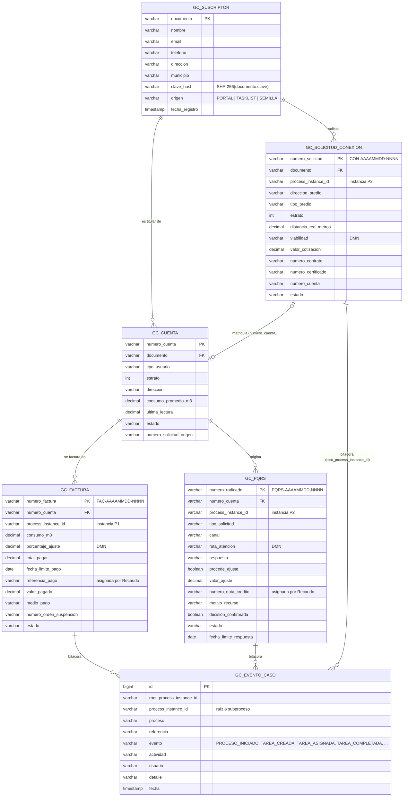
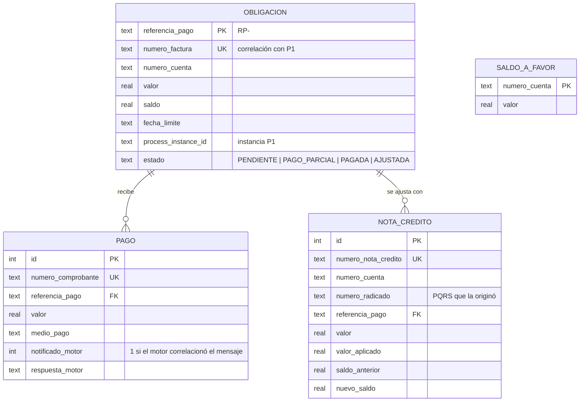

# Modelo de datos

El sistema tiene **dos almacenes de negocio** y el almacén propio de Camunda:

| Base | Dueño | Tecnología | Contenido | Inicialización |
|---|---|---|---|---|
| `./h2/camunda-db` | gas-corocora-motor | H2 2.x en archivo | `ACT_*` (Camunda: runtime, historia, identidad) + `GC_*` (negocio) | Camunda crea `ACT_*`; `schema.sql` y `data.sql` crean y siembran `GC_*` en cada arranque (idempotentes) |
| `./data/recaudo.db` | gas-corocora-recaudo | SQLite (`node:sqlite`) | Obligaciones, pagos, notas crédito, saldo a favor | `db/schema.sql` al iniciar (idempotente) |

## Modelo de negocio del motor (`GC_*`)



### Vínculo con las instancias de proceso

- Cada caso guarda el `process_instance_id` de su **instancia raíz** (P1, P2 o P3). La referencia de negocio (número de solicitud, factura o radicado) es la llave primaria y también la variable con la que se **correlacionan los mensajes**.
- `GC_EVENTO_CASO` guarda la instancia raíz y la del subproceso (call activity), de modo que la bitácora de un caso incluye lo ocurrido en *Construcción de acometida*, *Ajuste de factura* o *Suspensión del servicio*.
- Quién escribe: `SincronizacionNegocioListener` escucha los eventos del motor (Spring Eventing Bridge, `camunda.bpm.eventing.execution/task: true`). Al terminar cada actividad hace un *upsert* del caso con las variables del proceso; en cada tarea de usuario registra creación, asignación y completado con el usuario. Un error de persistencia se registra en el log y **no detiene el proceso**.
- Quién lee: `CasosService` combina la fila de negocio con el estado vivo del motor (estado de la instancia, tareas pendientes de la raíz y sus subprocesos, mensajes que espera) para los portales.

### Estados de negocio

| Caso | Estados |
|---|---|
| Solicitud de conexión | RADICADA, DEVUELTA, NO_VIABLE, CONTRATO_GENERADO, ESPERANDO_FIRMA, EN_CONSTRUCCION, OBRA_ESCALADA, CONECTADA |
| Factura | EN_REVISION, PENDIENTE_PAGO, PAGADA, PAGO_PARCIAL, EN_MORA, SUSPENDIDA |
| PQRS | RADICADA, RESPONDIDA, RECURSO_EN_TRAMITE, RECURSO_CONFIRMADO, RECURSO_A_FAVOR, EN_APELACION_SSPD |

### Datos semilla (`data.sql`)

| Documento | Nombre | Clave portal | Cuentas |
|---|---|---|---|
| 1122334455 | Ana Pérez | demo123 | CTA-1001 (residencial, estrato 2, promedio 20 m³, lectura 1000), CTA-1003 (residencial, estrato 2, promedio 15 m³, lectura 640) |
| 2233445566 | Carlos Gómez | demo123 | CTA-1002 (comercial, estrato 4, promedio 85 m³, lectura 5400) |
| 3344556677 | Lucía Rincón | demo123 | — (para probar la solicitud de conexión) |

Los usuarios **internos** no están en `GC_*`: son usuarios y grupos de la identidad de Camunda (`ACT_ID_USER`, `ACT_ID_GROUP`, `ACT_ID_MEMBERSHIP`), creados por `IdentidadInicializador` al arrancar.

## Modelo del servicio de Recaudo (SQLite)



## Consultas útiles para la demostración (consola H2)

```sql
-- Casos con su instancia de Camunda
SELECT numero_factura, numero_cuenta, total_pagar, referencia_pago, estado, process_instance_id FROM gc_factura;
SELECT numero_radicado, tipo_solicitud, ruta_atencion, procede_ajuste, numero_nota_credito, estado FROM gc_pqrs;
SELECT numero_solicitud, documento, viabilidad, valor_cotizacion, numero_contrato, numero_cuenta, estado FROM gc_solicitud_conexion;

-- Bitácora de un caso (reemplace la instancia)
SELECT fecha, evento, actividad, usuario, detalle FROM gc_evento_caso
WHERE root_process_instance_id = '<processInstanceId>' ORDER BY id;

-- Cruce con las tablas de Camunda: instancia y estado
SELECT f.numero_factura, h.STATE_, h.START_TIME_, h.END_TIME_
FROM gc_factura f JOIN ACT_HI_PROCINST h ON h.PROC_INST_ID_ = f.process_instance_id;
```
